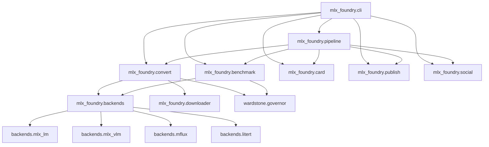

# MLX Foundry: Architecture Topology and System Canon

> **Positioning:** CLI and library pipeline for converting, quantizing, benchmarking, and publishing Hugging Face models to Apple MLX and LiteRT formats.
> **Target Hardware:** Apple Silicon Unified Memory (M1/M2/M3/M4) governed by `wardstone`.
> **License:** MIT.

---

## 1. Module Topology

---

## 2. Subsystem Contracts

### A. Single-Slot Hardware Governance (`convert.py`, `benchmark.py`)
* Both `convert_model` and `run_benchmark` (on uncached runs) integrate with optional `wardstone.governor` when available in the runtime environment, degrading gracefully with `gc.collect()` when `wardstone` is absent.
* When `wardstone` is installed, each entrypoint inspects host thermal and unified memory headroom via `ThermalResourceGovernor`, acquires `SlotLease.acquire(owner="mlx-foundry", model=..., preempt_sidecar=True)` before loading weights or launching conversion subprocesses, and releases the lease plus calls `flush_accelerator_cache()` inside `try/finally`.

### B. Multi-Backend Dispatch (`backends/`)
| Backend | Mode | Target Artifact | Notes |
|---|---|---|---|
| `mlx_lm` | Auto / Explicit | `*-mlx-{quant}bit/` | Causal LLMs via `mlx_lm.convert` (`2,3,4,6,8,16`-bit). |
| `mlx_vlm` | Auto / Explicit | `*-mlx-{quant}bit/` | Vision-language models with BF16 vision encoders. |
| `mflux` | Auto / Explicit | `*-mlx-{quant}bit/` | Diffusion transformers via `mflux-save`. |
| `litert` | Explicit Only | `*-litertlm-{quant}bit/` | Google AI Edge FlatBuffers via `ai-edge-torch`; fails closed if absent. |

### C. Snapshot Acquisition and Storage Hygiene (`downloader.py`, `batch_convert.py`)
* Downloads exclude non-MLX weights (`*.onnx`, `*.bin`, `*.pt`, `*.msgpack`, `*.h5`, `*.tflite`, `*.ot`) and symlink `pytorch_model-*.safetensors` shards to `model-*.safetensors` when required.
* Supports accelerated multi-connection fetching via `aria2c` (disableable with `MLX_FOUNDRY_NO_ARIA2=1`) and optional unquantized cache pruning (`--prune-source-cache`).

### D. Model Card Generation and Hub Publishing (`card.py`, `publish.py`)
* `generate_model_card` renders Jinja2 templates (`templates/model_card.md.j2`) separating measured `benchmark_results.json` metrics from heuristic hardware sizing matrices.
* `publish_model` enforces frontmatter metadata including `base_model_relation` (`quantized` by default across 4/8/16-bit conversions, or explicit `finetune`/`adapter`/`merge` overrides) and pushes to Hugging Face Hub.
